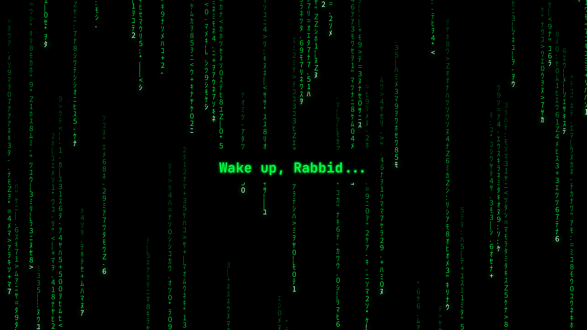

# 🦝 Matrix Lab — a Matrix-green desktop, for Linux

I turned a beat-up laptop with **4 GB of RAM and no graphics card** into a Matrix-green
cyber-lab. These are the three pieces that make it look the part, all generated with a
little Python, all free. Built on [Omarchy](https://omarchy.org) (Arch + Hyprland) but the
pieces work on most Linux desktops.

> **Zero GPU. Zero dollars. Zero excuses.**



## What's in here

| Piece | What it does |
|---|---|
| `cursor/make-raccoon-cursor.py` | An arrow cursor with a little **raccoon riding behind it**. Writes a real X cursor theme (24/32/48/64 px). |
| `wallpaper/make-live-wallpaper.py` | A **seamless looping** Matrix "digital rain" video — every drop loops perfectly, so it plays forever with no jump. Light on the CPU. |
| `wallpaper/make-still-wallpapers.py` | Still Matrix wallpapers (one with a glowing message in the middle). |

## Use it

You need Python with [Pillow](https://python-pillow.org/), a CJK font (for the katakana),
`ffmpeg` (for the video), and a wallpaper player like
[mpvpaper](https://github.com/GhostNaN/mpvpaper) for the live one.

```bash
# The raccoon cursor -> ~/.local/share/icons/Raccoon
python3 cursor/make-raccoon-cursor.py
mkdir -p ~/.local/share/icons/Raccoon/cursors
cp default ~/.local/share/icons/Raccoon/cursors/
printf '[Icon Theme]\nName=Raccoon\nInherits=Adwaita\n' > ~/.local/share/icons/Raccoon/index.theme
# then point your desktop's cursor theme at "Raccoon"

# A 20-second seamless Matrix loop -> matrix-rain.mp4
python3 wallpaper/make-live-wallpaper.py
ffmpeg -framerate 20 -i frames/%04d.png -c:v libx264 -crf 26 -pix_fmt yuv420p -tune animation matrix-rain.mp4
mpvpaper -p -o "no-audio loop" ALL matrix-rain.mp4

# Still wallpapers
python3 wallpaper/make-still-wallpapers.py
```

Edit the message and colors near the top of each script to make it yours.

## Me

Rabbid Raccoon — a Linux rookie running a whole crew of free AIs on one laptop, no GPU.
[Homepage](https://2db2du-byte.github.io) · [GitHub](https://github.com/2db2du-byte) · [Bluesky](https://bsky.app/profile/rabbid-raccoon.bsky.social) · [Blog](https://dev.to/rabbidraccoon)

MIT licensed. Have fun. 🦝
